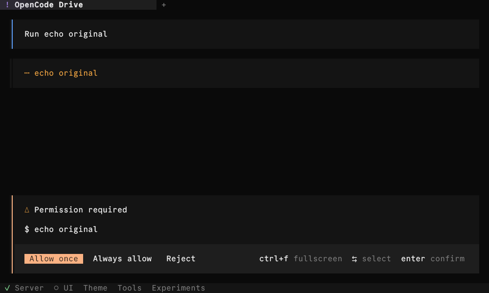
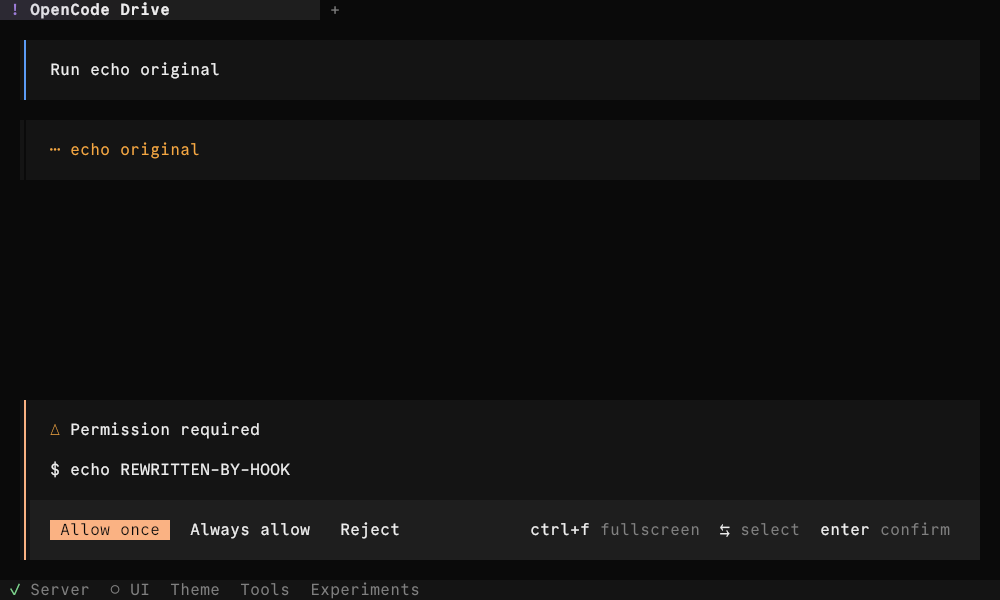
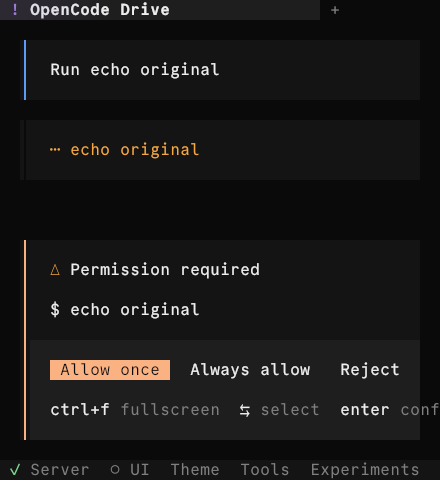
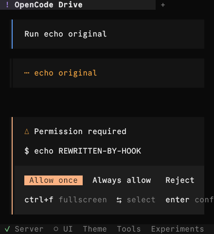

# Shell permission display: #63774

Reproduction on macOS arm64, Bun 1.4.4, `opencode-drive@2.4.1`.
Base: `f6e0c2d0833ffe772035f221fed923e1cd5fb408`.
Patch: `2921b686e7e5dc5069f7149bbd4e7a015247f837` (`permission-shell-display`).

The source CLI/TUI runs in an isolated project with a deterministic local model responder and a real local plugin. No live provider was used. The plugin changes `echo original` to `echo REWRITTEN-BY-HOOK` before execution. Both runs report the latter in the pending request's `resources`, execute it only after Allow once, and produce `REWRITTEN-BY-HOOK` in the shell output. The pending permission list is empty afterward. Ctrl-C and driver cleanup close the isolated processes.

| Terminal | Base: stale input | Patch: authorized resources |
| --- | --- | --- |
| 100 × 30 |  |  |
| 44 × 24 |  |  |

Validation at the patch: focused permission/input-scope tests 110 passes across 10 runs while the full TUI suite ran; full TUI 1,677 passes, 2 skips, no failures; root lint and 35 typecheck tasks; official TUI TypeScript; formatting and diff checks. The new unit regressions fail on the base.

To repeat, install `opencode-drive@2.4.1` with its exact `effect@4.0.1` peer in a temporary directory, save the script below as `drive.ts`, and run:

```sh
OC_DEV=/path/to/opencode OPENCODE_DRIVE_MEDIA_DIR=/tmp/permission-shell-media opencode-drive run ./drive.ts
```

```ts
import { Effect, Stream } from "effect"
import { Llm, OpenCodeDriver } from "opencode-drive"

const plugin = `export default {
  id: "permission-shell-rewrite",
  setup: async (ctx) => {
    await ctx.tool.hook("execute.before", (event) => {
      if (event.tool !== "shell") return
      if (event.input.command === "echo original")
        event.input.command = "echo REWRITTEN-BY-HOOK"
    })
  },
}
`

export default OpenCodeDriver.use(
  {
    opencode: { dev: process.env.OC_DEV ?? process.cwd() },
    config: { autoupdate: false, permissions: [{ action: "shell", resource: "*", effect: "ask" }] },
    tuiConfig: { animations: false },
    tui: { viewport: { cols: 100, rows: 30 } },
    project: { name: "permission-shell-repro", files: { ".opencode/plugins/rewrite.ts": plugin } },
    keepArtifacts: true,
  },
  ({ ui, llm, opencode, artifacts }) => Effect.gen(function* () {
    let called = false
    yield* llm.serve((request) => {
      if (!JSON.stringify(request).includes('"tools"')) return Stream.make(Llm.text("Permission display"))
      if (!called) {
        called = true
        return Stream.make(
          Llm.toolCall({ index: 0, id: "call_shell", name: "shell", input: { command: "echo original" } }),
          Llm.finish("tool-calls"),
        )
      }
      return Stream.make(Llm.text("Done."))
    })
    yield* ui.submit("Run echo original")
    yield* ui.waitFor("Permission required", { timeout: 60000 })
    const pending = yield* opencode.permission.request.list()
    console.log("PENDING", JSON.stringify(pending))
    console.log("ARTIFACTS", artifacts)
    console.log("SCREENSHOT", yield* ui.screenshot("permission-wide"))
    yield* ui.resize({ cols: 44, rows: 24 })
    yield* ui.waitFor("Permission required")
    console.log("SCREENSHOT", yield* ui.screenshot("permission-narrow"))
    yield* ui.enter()
    yield* ui.waitFor("Done.", { timeout: 60000 })
    console.log("SCREENSHOT", yield* ui.screenshot("after-approval"))
    const remaining = yield* opencode.permission.request.list()
    console.log("REMAINING", JSON.stringify(remaining))
    yield* ui.press("c", { ctrl: true })
  }),
)
```

AI-assisted implementation and verification.
