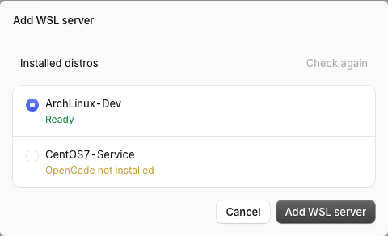
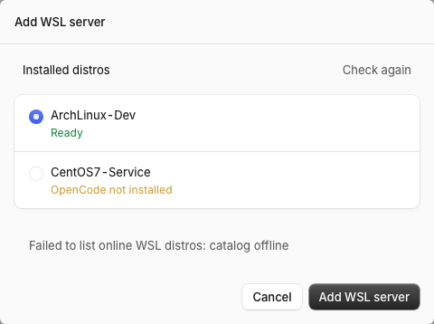
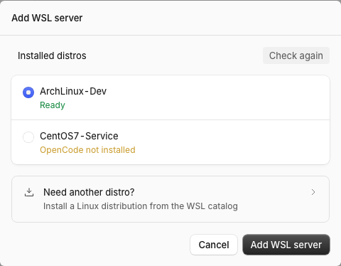

# OpenCode #64082: offline WSL discovery

Candidate: [offline-wsl-discovery](https://github.com/r266-tech/opencode/commit/6f4484dee06dddcce20b20e9170bf06dbfb8f65d) on `dev d432a06b9c`.

The local distribution list is published before the online catalog finishes. Catalog failures keep local distributions usable, show an inline error and write the underlying error to the main-process log. Installing a distribution no longer re-queries the online catalog afterwards.

## Reproduce and verify

Use Bun 1.4.4 and install the candidate with `bun install --frozen-lockfile`.

```sh
cd packages/gui-plugins
bun test src/wsl/servers.test.ts
bun test src/wsl --rerun-each 10 --randomize
bun run typecheck:tsc
cd ../..
bun run check
bun run lint:changed
cd packages/app
PLAYWRIGHT_PORT=4335 bun run test:e2e:built -- e2e/regression/settings-wsl.spec.ts --grep 'catalog loads' --project=chromium --workers=5 --repeat-each=10 --retries=0
```

The controller regression injects rejected and pending catalog promises through the existing `runtime` option. Restoring only `servers.ts` to `dev d432a06b9c` makes the rejected-catalog test fail with `catalog offline`; the candidate passes. The pending-catalog case adds an installed server and installs another distribution before releasing the catalog promise, then checks that its completion preserves the newer local list.

Local results on macOS arm64, Bun 1.4.4:

- GUI plugin suite: 1,132 passed, 1 native-WSL test skipped.
- WSL suite: 320 passes across 10 randomized runs; final controller tests: 40 passes across 10 randomized runs.
- Repository lint/all 35 typechecks, changed-file lint and official GUI-plugin TypeScript pass, including the actual pre-push hook.
- New built-app UI regression: 10/10 passes with 5 workers and no retries.
- Full WSL/SSH keeper: 12 passed, 1 existing test times out opening Settings after `Control+,`. An unmodified `dev d432a06b9c` build fails at the same assertion. This is not reported as a fully passing keeper suite.

## UI recording

These are the real production GUI plugin and dialog, rendered through the repository's controlled desktop bridge/IPC fixture in headless Chromium 148. They show the candidate's pending, failed and recovered catalog states; they are not native Windows/WSL recordings.

[Recording](catalog-states.webm)

| Catalog pending | Catalog offline | Catalog recovered |
| --- | --- | --- |
|  |  |  |

Native Windows/WSL and the Electron main process have not been verified. No model/provider requests were made. AI-assisted implementation and validation.
