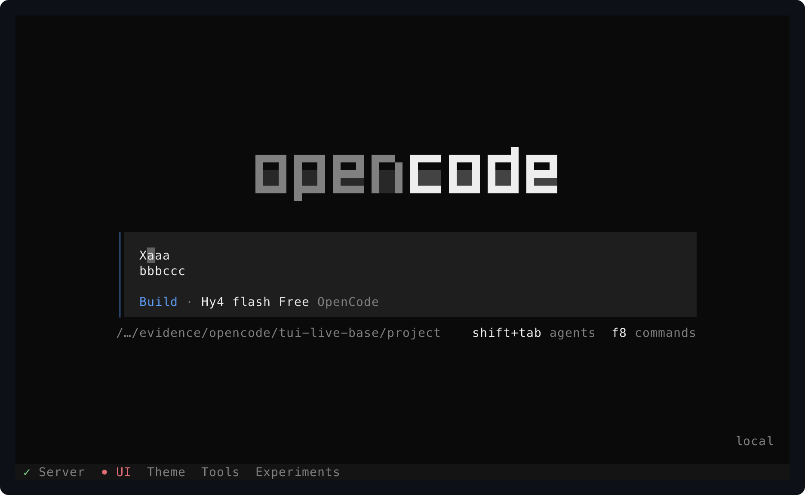
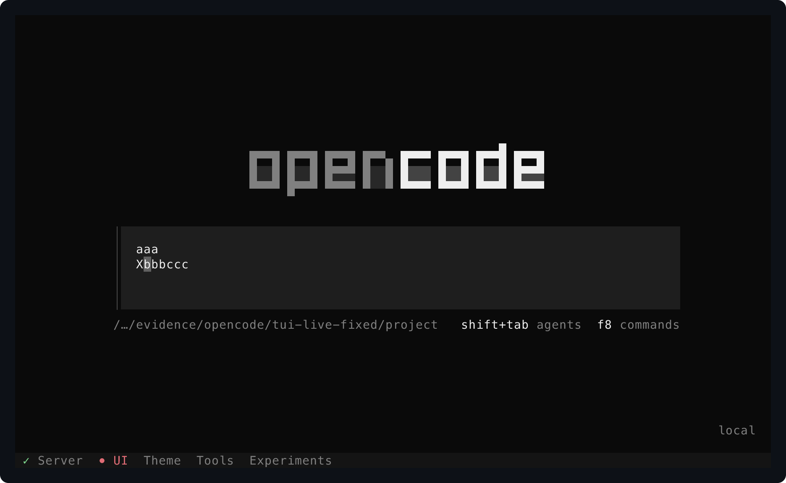

# Input keybinding hot reload — #64415

Candidate: [`53179733eb6b520b43a58f3e37ce16d1143e78e7`](https://github.com/r266-tech/opencode/commit/53179733eb6b520b43a58f3e37ce16d1143e78e7), based on upstream `dev` at `db9e9d69ac65030016711887dbde5d1802ae19ca`.

The textarea layer captured `input.*` bindings when the provider mounted. The candidate updates the bindings through `useBindings`, which keeps a stable layer slot so later command layers retain precedence. Edit-buffer commands and textarea mapping suspension stay registered for the component lifetime.

## Real CLI comparison

Both screenshots come from the actual CLI with an isolated config and standalone local server on macOS arm64. No prompt was submitted. Windows Terminal was not tested.

1. Start with no `input.*` overrides in `cli.json`.
2. Enter `aaa`, a newline, then `bbbccc`; position the cursor between `bbb` and `ccc`.
3. While the TUI remains running, add the issue's four input bindings and set `command.palette.show` to `f8` in the same file. The footer changes to `f8 commands`, proving that the configuration file was reloaded.
4. Press Home, then type `X`.

Baseline inserts `X` on the first line. The candidate inserts it at the beginning of the second line.

| Baseline | Candidate |
| --- | --- |
|  |  |

In the same candidate process, changing Home to `input.buffer.end` moved to the buffer end; removing the input overrides restored the default buffer-home behavior.

## Automated checks

- Real `ConfigProvider` → `Keymap.Provider` → textarea keyboard regression: additions, changes, removal, Home/End/Ctrl+Home/Ctrl+End, command-layer precedence, preserved text and focus.
- Keymap/config/scope tests: 32 passed.
- Keymap tests repeated ten times: 70 passed, 230 assertions.
- Full TUI suite (`bun run test` in `packages/tui`): 1678 passed, 2 skipped, 0 failed, 198 files.
- Root `bun run check`: 35 tasks passed.
- TUI `bun run typecheck:tsc`: passed.
- `git diff --check`: passed.

External CI has not run for this candidate. The screenshots and logs describe the tested baseline above, not later unrelated upstream commits.
